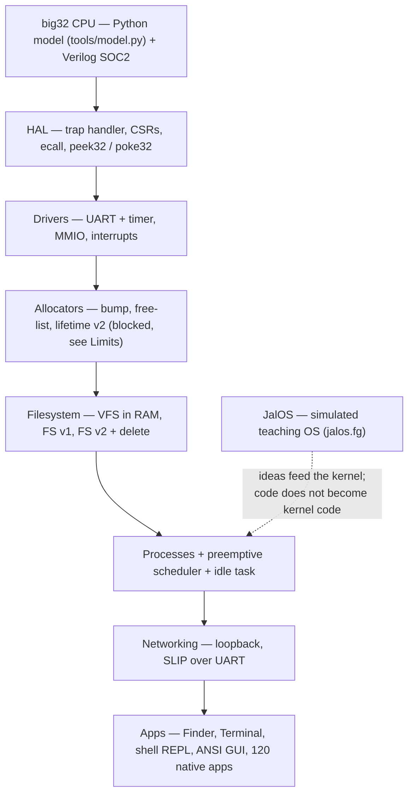
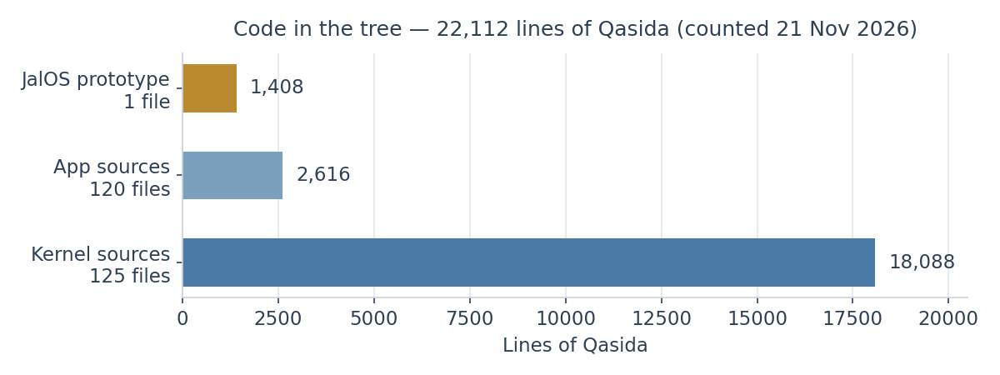
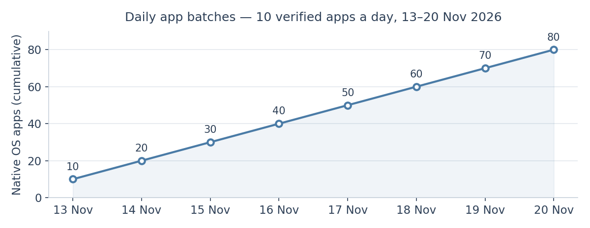

# MOON-OS

An operating system written from scratch in [Qasida](https://pypi.org/project/qasida/) — Jayant Dubey's own programming language — targeting big32, a RISC-V CPU. No Linux anywhere in the stack: its own kernel, drivers, filesystem, shell, GUI, and networking, built on its own CPU and in its own language.

[](https://pypi.org/project/qasida/)
[](https://github.com/themythofsisyphusjayant/BIG-32)
[](tests/)

The goal, set 27 October 2026: recreate something bigger than TempleOS, completely in his own programming language.

## The problem

A language can only prove itself by what it can build. Qasida was designed for safe, simple, fast tools — but the strongest test of a language is whether it can hold up an operating system: raw memory, interrupts, scheduling, and a filesystem, with no runtime underneath to catch mistakes. MOON-OS is that test, run in the open. Every kernel here builds freestanding for big32 (`qasida build --target big32 --freestanding` — no libc, own `_start`) and proves itself the same way: by the exact UART transcript it prints on the CPU model.

## What lives here

Two things:

- **`examples/os/kernel_*.fg` — freestanding kernels for the big32 CPU.** Processes, a preemptive timer scheduler, allocators, a filesystem, a shell REPL, ANSI GUI windows, UART/timer drivers, and a loopback network stack. [`kernel_unified.fg`](examples/os/kernel_unified.fg) (866 lines) combines all Phase F subsystems in one kernel on one memory map, with the idle task integrated (13 Nov 2026). The desktop apps are separate kernels: the interactive desktop ([`kernel_mac_interactive.fg`](examples/os/kernel_mac_interactive.fg)), the Finder app ([`kernel_finder.fg`](examples/os/kernel_finder.fg)), and the Terminal app ([`kernel_term.fg`](examples/os/kernel_term.fg)).
- **`examples/os/jalos.fg` — JalOS, the simulated teaching OS** (1,408 lines, ~30 shell commands, VFS, users, cron, package manager). It runs on top of a host OS; its ideas feed the kernel, its code does not become kernel code. See `examples/os/README.md`.

Each test asserts an exact UART transcript: the OS proves itself by what it prints.

## Architecture



Layers, bottom to top: big32 CPU (Python model + Verilog SOC2) → HAL (trap handler, CSRs, `ecall`, raw memory) → drivers (UART + timer, MMIO, interrupts) → allocators (bump, free-list, lifetime v2) → filesystem (VFS in RAM, FS v1, FS v2 + delete) → processes and preemptive scheduler → networking (loopback, SLIP over UART) → apps (Finder, Terminal, shell REPL, ANSI GUI windows).

The language is the foundation: Qasida's freestanding mode (`--freestanding`), raw memory (`peek32`/`poke32`), bitwise operators, CSR builtins, `ecall`, and the `trap_handler` hook are what make a kernel in Qasida possible at all. The roadmap is `docs/FREESTANDING.md`; the phase log is `docs/PROGRESS.md`.

## Contents

Counted from this tree, 28 Nov 2026 (re-verified for this README):

| Measure | Value |
|---|---|
| Qasida sources | 256 `.fg` files — 22,415 lines |
| Kernel sources | 125 `kernel_*.fg` — 18,088 lines |
| App sources | 130 `app_*.fg` — 2,919 lines |
| JalOS (simulated prototype) | `jalos.fg` — 1,408 lines |
| Unified kernel | `kernel_unified.fg` — 866 lines |
| Test files | 127 `test_kernel_*.py` — 9,350 lines, plus 9 daily app-batch tests (13–20 Nov + 28 Nov 2026) |



The kernels dominate the tree (18,088 of 22,415 lines); the 130 app sources are small, single-purpose programs — each one a Unix-style utility reimplemented in Qasida.

## Progress

| Phase | What landed |
|---|---|
| A–E | Bitwise ops, raw memory, freestanding mode, CSRs + trap handler + `ecall`, model timer, preemptive scheduler |
| F (9 checkpoints) | Bump allocator, free-list allocator, FS v1, FS v2 + delete, processes, shell REPL, ANSI GUI, drivers (UART + timer), loopback networking (SLIP) |
| Unified kernel | All Phase F subsystems in one kernel, one memory map; idle task integrated 13 Nov 2026 |
| Desktop | Interactive desktop (pointer, drag, close, live clock), Finder, Terminal — SOC2-only tests, currently skipped (see below) |
| Idle task (13 Nov 2026) | `sleep()` with no ready task now blocks instead of resuming immediately |
| Daily app batches (13–20 Nov + 28 Nov 2026) | 10 native OS apps per day, each with a test asserting exact stdout under both compilers |

### Daily app batches — 90 apps in 9 days

Ninety of the 130 app sources landed 13–20 Nov and 28 Nov 2026, ten a day, each batch pushed the same day with its test (`tests/test_daily_YYYYMMDD_os.py`, 40 checks, 0 failures, both compilers — per each batch's push commit). The 17–18 Nov push covered two days' batches (20 apps) in one commit.

| Date | Apps (10 per day) |
|---|---|
| 13 Nov | touch, mkdir, rm, mv, more, cut, tr, comm, diff, cal |
| 14 Nov | basename, dirname, tee, yes, id, whoami, uname, hostname, which, free |
| 15 Nov | expand, fold, join, paste, split, od, stat, tty, cpuinfo, lsmod |
| 16 Nov | awk, sed, cmp, pr, fmt, unexpand, tsort, cksum, base64, hexdump |
| 17 Nov | ln, rmdir, chown, who, wall, clear, stty, factor, expr, test |
| 18 Nov | sleep, true, false, xargs, find, watch, timeout, printf, last, umask |
| 19 Nov | dd, nohup, sync, tar, shuf, groups, logname, unlink, renice, vmstat |
| 20 Nov | dmesg, lspci, lsblk, pstree, lsof, printenv, nproc, hostid, time, size |
| 28 Nov | chgrp, pgrep, pidof, killall, w, finger, logger, iostat, lscpu, blkid |



The other 40 app sources predate the daily cadence (the core utilities: `cat`, `cp`, `ls`, `ps`, `grep`, `sort`, `wc`, and the rest).

## Verified results

Full standalone run, 13 Nov 2026, from this tree (fresh venv, `pip install qasida` 2.2.0): **118/118 pass, 0 fail — 509 checks in 42.3 s.** The 9 SOC2-only tests printed their loud skip and exited 0 (counted as skipped, never as passes).

| Test | Result |
|---|---|
| `test_kernel_idle.py` | 8/8 pass — exact transcript `KERNA8DONE`, wake tick 8, final tick 9, 10,250 steps |
| `test_kernel_unified.py` | 7/7 pass — exact shell-tour transcript, 27 timer ticks, net 4/3/1 |
| `test_kernel_drivers.py` | 5/5 pass — exact transcript `KERNBADONE`, 7 timer ticks |
| `test_kernel_unified_idle.py` | 10/10 pass — sleep blocks via the idle task: `Z4` start, `K10` wake (diff 6 ≥ 5 ticks), idle pid 1, sleeper pid 2 |
| All 118 standalone tests | 118/118 pass — 509 checks, 0 failures, 42.3 s |

The unified kernel's shell tour answers `h p s w m f g n q` (help, processes, shell, window, memory, files, GUI, network, quit) and halts cleanly with `BYE`. When no task is ready, the scheduler runs an idle task that waits for the next timer interrupt.

The 13 Nov run predates the 14–20 Nov app batches. Those batches were each verified at push time (40 checks, 0 failures, both compilers — see the table above); a fresh full-suite run after the 20 Nov batch has not been recorded yet.

Fresh full standalone run, 28 Nov 2026 (same runner, `blackmoon-iso/daily-20261128/os_fullrun.log`): **118 pass / 0 fail / 9 skip of 127 kernel tests, 24.6 s** — the kernel suite is unchanged-green after the 28 Nov app batch. The 28 Nov batch itself is covered by its own test, `tests/test_daily_20261128_os.py` — **40 checks, 0 failures, both compilers** (chgrp, pgrep, pidof, killall, w, finger, logger, iostat, lscpu, blkid).

## Reproduce

Prerequisites: Python 3.10+ and the Qasida compiler.

```sh
python3 -m venv .venv
source .venv/bin/activate
pip install qasida
```

Then, from the repo root:

```sh
python3 tests/test_kernel_idle.py      # idle task: sleep blocks (8 checks)
python3 tests/test_kernel_unified.py   # unified kernel, full shell tour
python3 tests/test_kernel_drivers.py   # UART + timer drivers
```

Each test builds its kernel freestanding for big32 and runs the resulting `.hex` on the vendored Python model of the CPU (`tools/model.py`).

Build a kernel by hand:

```sh
qasida build --target big32 --freestanding examples/os/kernel_unified.fg -o out/kernel_unified
# -> out/kernel_unified.hex, run on the model with tools/model.py
```

Run the simulated teaching OS on the host (no big32 needed):

```sh
qasida run examples/os/jalos.fg            # built-in demo tour
qasida run examples/os/jalos.fg script.txt  # run a script file
qasida run examples/os/jalos.fg ps          # a single command
```

The tests resolve the compiler as:

1. `qasida` on `PATH` (the `pip install qasida` case above), else
2. `$QASIDA_BIN` — a `qasida` binary, or a `forge.py` checkout (a `.py` path is run via `sys.executable`), else
3. a hard error naming both options.

```sh
# Example: use a local Qasida checkout instead of the pip package
QASIDA_BIN=/path/to/forge.py python3 tests/test_kernel_idle.py
```

No RED-MOON- paths are hard-coded anywhere in this repo.

## Relationship to the other repos

- **Qasida (the language/compiler)** — the compiler this OS is written in. Install it with `pip install qasida`; its source lives in [RED-MOON-](https://github.com/themythofsisyphusjayant/RED-MOON-). Freestanding mode is documented in `docs/FREESTANDING.md` (also kept in RED-MOON- as `docs/FREESTANDING.md`). Current release: 2.3.0 (16 Nov 2026).
- **big32 (the CPU + Verilog SOC)** — the kernels target the big32 CPU. The Python behavioural model of that CPU is vendored here as `tools/model.py` (source: BIG-32 `tools/model.py`; stdlib-only, one import: `sys`; see the provenance header in the file). The Verilog SOC itself is not vendored — see the SOC tests note below.
- **`tools/rebase_soc2.py`** — vendored from RED-MOON- `tools/`. It rebases a kernel from the model's flat 64 KB memory map to SOC2 RAM at `0x80000000` for the Verilog-SOC tests.

## Layout

```text
examples/os/     246 .fg kernel/app sources + JalOS README
tests/           127 test_kernel_*.py + 8 daily app-batch tests (resolve qasida from PATH)
tools/           model.py (vendored big32 model), rebase_soc2.py (vendored)
docs/            FREESTANDING.md (freestanding-mode reference)
                 PROGRESS.md (phase log, kept with history)
                 composition.png, growth.png (figures for this README)
```

## Limits

- **Not bootable on real hardware yet.** Kernels are verified on the Python big32 model (and, for the SOC tests, on the Verilog SOC simulation). There is no physical silicon; do not claim otherwise.
- **No persistence.** The VFS lives in RAM.
- **1 child slot only** in the unified kernel (slot 2; slot 1 is the idle task — a third stack would grow through kernel regions).
- **Palette indices only** (0–9), no palette register.
- **Lifetime allocator v2 is blocked** (20 Nov 2026): the adopted kernel builds to 4,319 words, over the Python big32 model's 4,096-word instruction memory, so the model wraps the program counter to 0 and the kernel restarts in a loop. The route round this — a slimmer allocator, freeing room elsewhere, or the SOC2 instruction-memory route — is undecided.

### The 9 SOC tests are not standalone

`test_kernel_fb.py`, `test_kernel_finder.py`, `test_kernel_full.py`, `test_kernel_mac.py`, `test_kernel_mac_int.py`, `test_kernel_netdev.py`, `test_kernel_pix.py`, `test_kernel_term.py`, and `test_kernel_uart16550_soc2.py` additionally need a BIG-32 checkout (`src/big32_core_pipe.v`, `src/big32_soc2.v`), the rx-proof testbenches (`tb_*.v`), and `iverilog` on `PATH`. Point at them with:

```sh
BIG32_DIR=/path/to/big32 RX_PROOF_DIR=/path/to/rx-proof python3 tests/test_kernel_fb.py
```

Without those, they print `SKIP SOC2 test ...` and exit 0 — a loud skip, not a pass. `iverilog` is currently absent from this environment, so the 9 SOC tests skip until it is restored. The other 118 tests are fully standalone: compiler + this repo is all they need.

## What's next

- Lifetime allocator v2 into the unified kernel — pending a decision on the instruction-memory limit above.
- SOC2 re-verification of the desktop kernels once `iverilog` is restored.
- Then: Notes as a third desktop app, and the long road toward the TempleOS-sized goal — one verified slice at a time.

## Links

- The language: [RED-MOON- (Qasida source)](https://github.com/themythofsisyphusjayant/RED-MOON-) · [Qasida on PyPI](https://pypi.org/project/qasida/) (`pip install qasida`)
- The CPU: [BIG-32](https://github.com/themythofsisyphusjayant/BIG-32)
- Docs: [docs/FREESTANDING.md](docs/FREESTANDING.md) (freestanding-mode reference + OS roadmap) · [docs/PROGRESS.md](docs/PROGRESS.md) (phase log)
