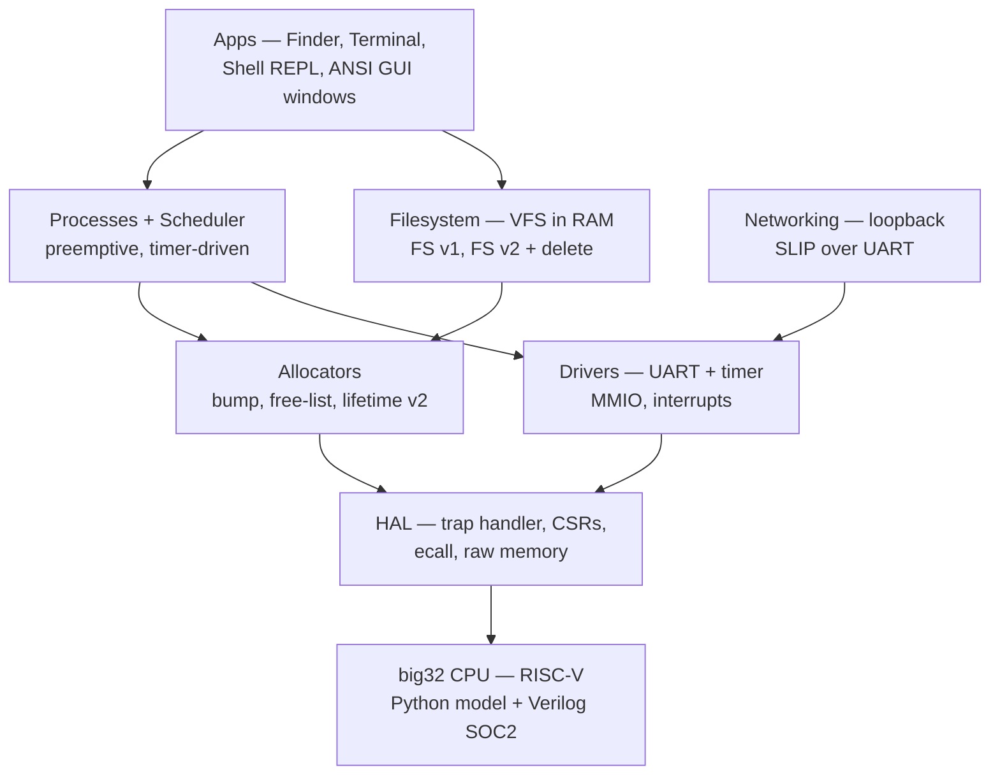
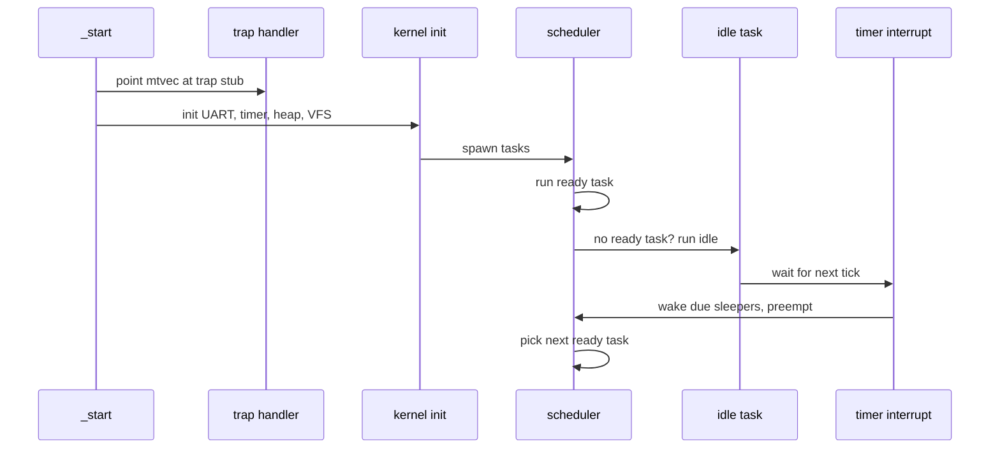
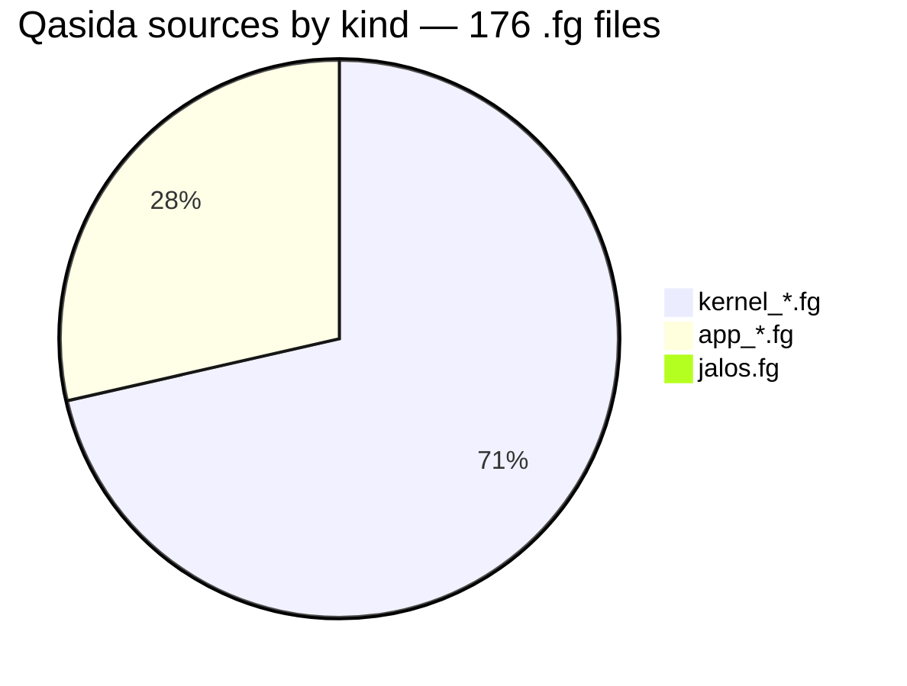

# MOON-OS — a from-scratch OS in Qasida

> **An operating system written completely in [Qasida](https://pypi.org/project/qasida/) — Jayant's own language — running on big32, his own RISC-V CPU. No Linux anywhere.**

> The goal, in Jayant's words (27 Oct 2026): *"recreate something bigger than TempleOS, completely in his own programming language."* Its own kernel, drivers, filesystem, shell, GUI, and networking — built on its own CPU and in its own language.


---

## 🌙 Two things live here

- **`examples/os/kernel_*.fg` — real freestanding kernels for the big32 CPU.** Processes, a preemptive timer scheduler, allocators, a filesystem, a shell REPL, ANSI GUI windows, UART/timer drivers, and a loopback network stack. [`kernel_unified.fg`](examples/os/kernel_unified.fg) (866 lines) puts all Phase F subsystems in one kernel on one memory map, with the idle task integrated (13 Nov 2026; [`test_kernel_unified.py`](tests/test_kernel_unified.py), 7/7 PASS). The desktop apps are separate kernels: the interactive desktop ([`kernel_mac_interactive.fg`](examples/os/kernel_mac_interactive.fg)), the Finder app ([`kernel_finder.fg`](examples/os/kernel_finder.fg)), and the Terminal app ([`kernel_term.fg`](examples/os/kernel_term.fg)).
- **`examples/os/jalos.fg` — JalOS, the *simulated* teaching OS** (1,408 lines, ~30 shell commands, VFS, users, cron, package manager). It runs on top of a host OS; its ideas feed the kernel, its code does not become kernel code. See `examples/os/README.md`.

Every kernel builds freestanding for big32 (`qasida build --target big32 --freestanding` — no libc, own `_start`) and runs on the vendored Python model of the CPU (`tools/model.py`). Each test asserts an exact UART transcript: the OS proves itself by what it prints.

---

## 🧭 Architecture — layers of the moon



The language is the foundation: Qasida's freestanding mode (`--freestanding`), raw memory (`peek32`/`poke32`), bitwise operators, CSR builtins, `ecall`, and the `trap_handler` hook are what make a kernel in Qasida possible at all. The roadmap is `docs/FREESTANDING.md`.



---

## 📊 At a glance (counted from this tree, 12 Nov 2026)

| Measure | Value |
|---|---|
| Qasida sources | **176 `.fg` files — 20,811 lines** |
| Kernel sources | 125 `kernel_*.fg` — 18,088 lines |
| App sources | 50 `app_*.fg` — 1,315 lines |
| JalOS (simulated prototype) | `jalos.fg` — 1,408 lines |
| Unified kernel | `kernel_unified.fg` — 866 lines |
| Test files | **127 `test_kernel_*.py` — 9,350 lines** |
| Standalone tests | 118 (compiler + this repo only) |
| SOC2-only tests | 9 (need a BIG-32 checkout + `iverilog` — loud skip, not a pass) |
| Phases done | A–E + F (9 checkpoints) + idle task |



### 🗺️ Progress so far

| Phase | What landed |
|---|---|
| **A–E** | Bitwise ops, raw memory, freestanding mode, CSRs + trap handler + `ecall`, model timer, preemptive scheduler |
| **F (9 checkpoints)** | Bump allocator, free-list allocator, FS v1, FS v2 + delete, processes, shell REPL, ANSI GUI, drivers (UART + timer), loopback networking (SLIP) |
| **Unified** | [`kernel_unified.fg`](examples/os/kernel_unified.fg) — all Phase F subsystems in one kernel, one memory map; idle task integrated 13 Nov 2026 |
| **Desktop** | Interactive desktop ([`kernel_mac_interactive.fg`](examples/os/kernel_mac_interactive.fg): pointer, drag, close, live clock), Finder ([`kernel_finder.fg`](examples/os/kernel_finder.fg)), Terminal ([`kernel_term.fg`](examples/os/kernel_term.fg)) — SOC2-only tests, currently skipped (see below) |
| **Idle task (12 Nov 2026)** | `kernel_idle.fg` — `sleep()` with no ready task now blocks instead of resuming immediately |

Full history: `docs/PROGRESS.md`.

---

## 🖥️ What runs today

- **Interactive desktop** — pointer, drag, close, live mtime clock, in [`kernel_mac_interactive.fg`](examples/os/kernel_mac_interactive.fg) (polls the pointer device; click a title bar for focus, drag a window by its title bar, close via the red traffic light; the clock reads live mtime) — proved by [`tests/test_kernel_mac_int.py`](tests/test_kernel_mac_int.py), which scripts the pointer (click Finder title, drag Finder +50/+50, close Finder) and checks pixels plus the clock's format/position. It grew out of the macOS-look *static* desktop in [`kernel_mac.fg`](examples/os/kernel_mac.fg) (the clock is a static `21:22` mock and there is no pointer interaction yet — its own header says so), proved by [`tests/test_kernel_mac.py`](tests/test_kernel_mac.py). Both desktop tests are SOC2-only and currently skipped here (need a BIG-32 checkout + `iverilog`); pixel VRAM is 640×480.
- **Finder app** — an FS-backed file list in a window ([`kernel_finder.fg`](examples/os/kernel_finder.fg), proved by [`tests/test_kernel_finder.py`](tests/test_kernel_finder.py): lists the three boot-created files FILE 1/2/3, click row 1 to select, drag +50/+50; SOC2-only, currently skipped).
- **Terminal app** — a 16×38 text buffer in a window, with first-character shell dispatch ([`kernel_term.fg`](examples/os/kernel_term.fg), proved by [`tests/test_kernel_term.py`](tests/test_kernel_term.py); SOC2-only, currently skipped).
- **Shell tour** — the unified kernel answers `h p s w m f g n q` (help, processes, shell, window, memory, files, GUI, network, quit) and halts cleanly with `BYE`.
- **Idle task** — when no task is ready, the scheduler runs an idle task that waits for the next timer interrupt. `sleep(5)` wakes at tick 8 and the run halts at tick 9, after exactly 10,250 model steps — the wait is proven, not assumed.

### ✅ Verified test results

Full standalone run, 13 Nov 2026, from this tree (fresh venv, `pip install qasida` 2.2.0): **118/118 pass, 0 fail — 509 checks in 42.3 s.** The 9 SOC2-only tests printed their loud skip and exited 0 (counted as skipped, never as passes). The headline tests:

| Test | Result |
|---|---|
| `test_kernel_idle.py` | **8/8 PASS** — exact transcript `KERNA8DONE`, wake tick 8, final tick 9, 10,250 steps |
| `test_kernel_unified.py` | **7/7 PASS** — exact shell-tour transcript, 25 timer ticks, net 4/3/1 |
| `test_kernel_drivers.py` | **5/5 PASS** — exact transcript `KERNBADONE`, 7 timer ticks |
| `test_kernel_unified_idle.py` | **10/10 PASS** — sleep blocks via the idle task: `Z4` start, `K10` wake (diff 6 ≥ 5 ticks), idle pid 1, sleeper pid 2 |
| **All 118 standalone tests** | **118/118 PASS — 509 checks, 0 failures, 42.3 s** |
| 9 SOC2-only tests (`fb`, `finder`, `full`, `mac`, `mac_int`, `netdev`, `pix`, `term`, `uart16550_soc2`) | **SKIPPED** — need a BIG-32 checkout + `iverilog` (see below) |

---

## 🚀 Quickstart

Prerequisites: Python 3.10+ and the Qasida compiler.

```sh
python3 -m venv .venv
source .venv/bin/activate
pip install qasida
```

Then, from the repo root:

```sh
python3 tests/test_kernel_idle.py      # idle task: sleep blocks (8 checks)
python3 tests/test_kernel_unified.py   # unified kernel, full shell tour
python3 tests/test_kernel_drivers.py   # UART + timer drivers
```

Each test builds its kernel freestanding for big32 and runs the resulting `.hex` on the vendored Python model of the CPU (`tools/model.py`).

### Finding the compiler

The tests resolve the compiler as:

1. `qasida` on `PATH` (the `pip install qasida` case above), else
2. `$QASIDA_BIN` — a `qasida` binary, or a `forge.py` checkout
   (a `.py` path is run via `sys.executable`), else
3. a hard error naming both options.

```sh
# Example: use a local Qasida checkout instead of the pip package
QASIDA_BIN=/path/to/forge.py python3 tests/test_kernel_idle.py
```

No RED-MOON- paths are hard-coded anywhere in this repo.

---

## 🔗 Relationship to the other repos

- **Qasida (the language/compiler)** — the compiler this OS is written in. Install it with `pip install qasida`; its source lives in [RED-MOON-](https://github.com/themythofsisyphusjayant/RED-MOON-). Freestanding mode is documented in `docs/FREESTANDING.md` (also kept in RED-MOON- as `docs/FREESTANDING.md`).
- **BIG-32 (the CPU + Verilog SOC)** — the kernels target the big32 CPU. The Python behavioural model of that CPU is vendored here as `tools/model.py` (source: BIG-32 `tools/model.py`; stdlib-only, one import: `sys`; see the provenance header in the file). The Verilog SOC itself is *not* vendored — see the SOC tests note below.
- **`tools/rebase_soc2.py`** — vendored from RED-MOON- `tools/`. It rebases a kernel from the model's flat 64 KB memory map to SOC2 RAM at `0x80000000` for the Verilog-SOC tests.

## 📁 Layout

```text
examples/os/     176 .fg kernel/app sources + JalOS README
tests/           127 test_kernel_*.py (resolve qasida from PATH)
tools/           model.py (vendored big32 model), rebase_soc2.py (vendored)
docs/            FREESTANDING.md (freestanding-mode reference)
                 PROGRESS.md (phase log, kept with history)
```

---

## ⚠️ Honest limits

- **Not bootable on real hardware yet** — kernels are verified on the Python big32 model (and, for the SOC tests, on the Verilog SOC simulation). There is no physical silicon; do not claim otherwise.
- **No persistence** — the VFS lives in RAM.
- **1 child slot only** in the unified kernel (slot 2; slot 1 is the idle task — a third stack would grow through kernel regions).
- **Palette indices only** (0–9), no palette register.
- The unified kernel's idle task is **integrated** (13 Nov 2026): [`kernel_unified.fg`](examples/os/kernel_unified.fg) runs the idle task in slot 1 (state 5, pid at `0x804C`), children use slot 2 only, and `sleep()` really blocks — the `z` demo starts at tick 4 and wakes at tick 10 ([`tests/test_kernel_unified_idle.py`](tests/test_kernel_unified_idle.py), 10/10 PASS). The standalone [`kernel_idle.fg`](examples/os/kernel_idle.fg) still exists.

### The 9 SOC tests are not standalone

`test_kernel_fb.py`, `test_kernel_finder.py`, `test_kernel_full.py`, `test_kernel_mac.py`, `test_kernel_mac_int.py`, `test_kernel_netdev.py`, `test_kernel_pix.py`, `test_kernel_term.py`, and `test_kernel_uart16550_soc2.py` additionally need a BIG-32 checkout (`src/big32_core_pipe.v`, `src/big32_soc2.v`), the rx-proof testbenches (`tb_*.v`), and `iverilog` on `PATH`. Point at them with:

```sh
BIG32_DIR=/path/to/big32 RX_PROOF_DIR=/path/to/rx-proof python3 tests/test_kernel_fb.py
```

Without those, they print `SKIP SOC2 test ...` and exit 0 — **a loud skip, not a pass**. The other 117 tests are fully standalone: compiler + this repo is all they need.

---

## 🗺️ What's next

- **Lifetime allocator v2** into the unified kernel (lifetime-ordered allocation, QAIRT borrow).
- **SOC2 re-verification** of the desktop kernels once `iverilog` is restored in the environment (currently absent — the 9 SOC tests skip loudly until then).
- Then: Notes as a third desktop app, and the long road toward the TempleOS-sized goal — one verified slice at a time.

---

## 🔗 Links

- **The language:** [RED-MOON- (Qasida source)](https://github.com/themythofsisyphusjayant/RED-MOON-) · [Qasida on PyPI](https://pypi.org/project/qasida/) (`pip install qasida`)
- **Docs:** [docs/FREESTANDING.md](docs/FREESTANDING.md) (freestanding-mode reference + OS roadmap) · [docs/PROGRESS.md](docs/PROGRESS.md) (phase log)
